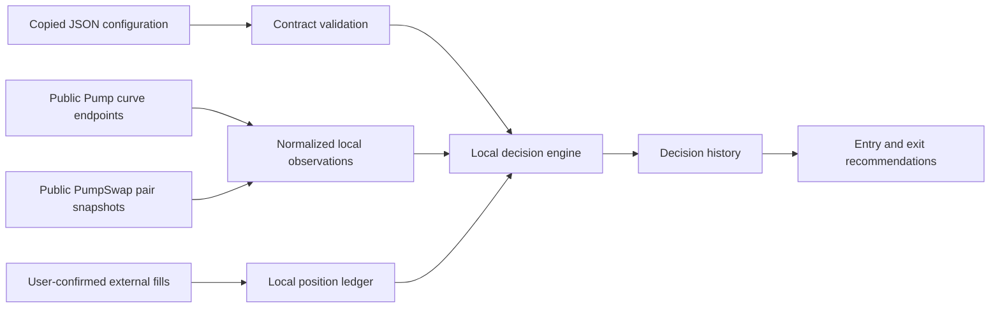

# Local monitoring contract

The local monitor is a data and decision layer. It consumes a copied strategy
configuration, collects its own market observations, and writes its own SQLite
history. It does not fetch hosted strategy telemetry or use a hosted service at
runtime.

## Configuration handling

`pumpwizard.strategy-handoff/v1` is accepted as input data. The monitor runs a
handoff only when it is a complete `early-ladder-v1` paper-ladder contract: the
strategy version, entry band, sample window, liquidity/cost limits, ownership
policy, exits, and ordered targets must all validate. The retained package hash
identifies the exact copied rules.

For that profile, the local engine applies the entry style, observation window,
price-change and reserve-growth checks, market-cap and peak-drawdown checks,
strict ownership gate, modeled liquidity/cost screen, target steps, stop,
trail, holding limit, and quote-gap exit conditions. Research-family profiles
also retain their local pool-continuity and peer calculations.

The monitor records recommendations. It has no execution path, so its use of
the legacy modeled entry-cost screen is only a compatibility gate; it is not a
claim that an executable swap quote will match it.

## Local data flow



The bundled curve collector accepts only fixed read-only public Pump paths and
only normalized SOL bonding-curve quotes for entry discovery. It keeps held
mints in the collection set. When a held mint has no usable curve quote, a
second fixed read-only collector checks its Solana PumpSwap pair snapshots and
uses the deepest accepted SOL pair as an AMM observation. This preserves local
price observations after graduation. Ladder modeled sell values require original
entry-pool context and verified migration state; the ledger does not yet establish
migration state, so it cannot value a ladder exit on AMM data. It never discovers an AMM entry,
chooses a swap route, or turns an aggregator price into an executable quote.

## Runtime health

The desktop scheduler scans up to four distinct market-cap bands concurrently.
Agents in an identical band share a batch, but each restores its own observations,
checkpoint, ownership evidence, and positions. A successful or failed scan schedules
the next attempt 15 seconds after completion; this is not a guaranteed 15-second
latency. Held mints are prioritized in bounded chunks. The general Trading market
watch remains a separate discovery feed.

Browser **Run monitor** persists across app restarts. **Stop monitor** stops new
entry recommendations; existing positions remain observed for exit safety.
**Scan now** requests one bounded pass. The strategy menu and full monitor show
the watched market-cap band, entry style, scan cadence, latest observed tokens,
current positions, scan results, decisions and both the wallet per-trade loss
limit and configured strategy exit. None of these controls places a trade.
Closing the app stops its scheduler; it is not an OS background service.
Existing agents require an explicit first run after upgrading.

An exclusive SQLite lease coordinates app windows and CLI monitor cycles. A second
window leaves monitoring to the owner; after a crash its lease can take up to three
minutes to expire. Atomic per-agent commits include observations, decisions, position
marks, and checkpoints. Pausing during a fetch invalidates that batch. Provider
outages retry automatically; local faults require **Retry tracking**. Configuration
and state are never silently replaced from the hosted simulation catalog.

The desktop currently uses locally recorded ownership evidence; it does not configure
an ownership RPC scanner. Strict strategies remain blocked when that evidence is
missing or stale. The CLI ownership workflow below remains available.

`monitor INSTANCE_ID --interval SECONDS` runs a local collection loop at a
bounded 5–3600 second cadence. Each completed or failed collection cycle is
stored in `monitor_runs`; a temporary public-market outage is recorded and
retried on the next interval. The loop reads the instance state before each
cycle, so `pause INSTANCE_ID` stops it without losing observations or strategy
state. `monitor-runs INSTANCE_ID` shows the durable health history.

Only public market-data errors are retried automatically. Invalid local
configuration or database errors stop the process, because silently retrying a
local fault would hide a state problem from the user.

## Reference verification

Dev32 adds a separate [core-frequency portfolio replay](PORTFOLIO-REPLAY.md)
with 24 independently captured full transition sequences, including virtual
fills, funding, pending timing and re-entry rules. Its isolated replay ledger
does not turn modeled fills into desktop monitor positions or live orders.
The earlier screen-only fixture described below remains in use.

`tests/fixtures/momentum-reference.json` contains frozen output from the original
PumpWizard `LadderRunner` for the `core-frequency` momentum configuration, with
source hashes. Eleven entry scenarios compare rejection reasons and complete
rolling histories, including rebuilding the engine after each observation. Fifteen
exit scenarios compare modeled net sell value and the initial exit decision,
and reject missing entry-route context. These cover growing and flat markets,
FX-only changes, reserve growth, gaps, band/drawdown gates, stops, targets,
trails, ownership flags, holding limits, and unavailable quotes. Four cases added
in dev31 supply a partially sold position to verify its remaining-cost valuation,
remaining targets, stop and trail. The expected values come from the same hashed
reference checkout; this does not verify how its fill scheduler creates that state.

Regenerate deliberately against a reviewed local reference checkout:

```bash
PYTHONPATH=src python3 packaging/capture_reference_cases.py --pumpwizard-root /path/to/pump-agent
```

The fixture generator is a development tool only. Runtime does not import or contact
PumpWizard. These checks do not verify fills, portfolio funding, pending-order
timing, re-entry after confirmed exits, strict ownership-policy equivalence,
graduation, or other strategy families. No family is advertised as fully
parity-verified yet. Different market observations can still produce different
decisions even after a full rule-port is verified.

## Ownership evidence

Wallet resource holds are separate from ownership evidence and dry-run orders.
See [agent reservations](AGENT-RESERVATIONS.md) for per-agent exact-unit
reserve/list/release commands and the remaining execution boundary.

A copied strategy cannot name an RPC endpoint or supply a safety verdict. For a
strict ownership gate, the user supplies an HTTPS endpoint through an
environment variable and starts the monitor with `--ownership-rpc-env NAME`.
The runner uses fixed read-only `getAccountInfo` and `getProgramAccounts` RPC
requests, stores the result locally, and refreshes at most two stale candidate
mints per collection cycle. Without a fresh local `clear` record, strict entry
remains blocked.

`ownership-basic-v1` checks current mint and freeze authorities, parsed
Token-2022 extensions, reconciled current holder-account balances, verified
Pump bonding-curve vault exclusion, and one-holder/top-ten concentration
limits. It does not prove linked-wallet ownership or transaction history. Its
policy identifier and coverage statement are retained with every check, so a
future expanded policy will not silently replace old evidence.

## Position library

The position library starts empty. A user records a position only after a
separate, confirmed fill with `record-position`; the ledger then retains its
partial/full exit events, remaining quantity and cost, target stages, high-water
mark, and most recent usable quote. `record-exit` changes only that local
ledger. It cannot submit a swap.

For ladder cost screens, the ledger infers the entry curve only from a local
observation within 120 seconds before the recorded fill. Without that context,
modeled sell value is unavailable; spot price is not substituted for net proceeds.
Holding-limit and quote-gap recommendations remain available. Execution must
eventually persist confirmed fill and route metadata directly.

This distinction is intentional: local research and a user’s confirmed wallet
state must remain auditable before an executor is added.

## Public-address reconciliation

`wallet-check INSTANCE_ID ADDRESS --rpc-env NAME` reads the confirmed SOL
balance for `ADDRESS` and the parsed token-account balance for each open,
valid-Solana-mint position in that local instance. The snapshot is stored in
the library and can be reviewed with `wallet-history`. It does not rewrite a
position, treat a balance as a fill, or confirm any transaction.

The monitor's RPC interface is bounded to fixed read-only balance and
token-account methods. It does not accept a seed phrase, private key, keypair
file, browser-wallet connection, transaction payload, or signature. A future
executor must use the separately reviewed local signer boundary and reconcile
its submitted transactions against these public observations.

## Dry-run order sandbox

`executor-config` can enable only `disabled` or `dry-run` mode. Dry-run mode
requires a local maximum USD entry size, a slippage limit, and a short decision
time limit. `prepare-order` consumes only the newest actionable local decision
for a mint. A buy must name a spend at or below the local maximum and, where a
copied strategy defines `order_usd`, exactly equal that rule. A sell derives
its quantity from the current recorded position.

The persisted lifecycle is `draft`, `simulated`, or `cancelled`. `simulate-order`
reprices the draft with a fresh normalized local observation and verifies its
saved slippage minimum. It does not build a Solana instruction, contact a
transaction RPC endpoint, sign, reserve a balance, or submit. The output is an
auditable local price check only. A later executor must create new lifecycle
states for an on-chain simulation, signature, submission, confirmation, and
wallet reconciliation; it cannot reinterpret a dry-run result as one.

## Loopback signer check

`localnet-signing-check` is the first signing capability. It accepts a standard
64-byte Solana JSON keypair only when its file permissions exclude group and
other readers. It then builds one fixed System Program transfer for a different
public recipient, signs it in process, and sends it to a URL that must be HTTP
on `127.0.0.1:8899` or `[::1]:8899`. It refuses every other host, port, scheme,
path, redirect, RPC method, program, and instruction.

The keypair is not placed in the strategy, database, order plan, output, or RPC
payload. Only the public confirmation evidence is retained. This verifies the
local keyfile and signing/confirmation plumbing; it is not a wallet integration
or a token/Pump/PumpSwap transaction. Start a throwaway `solana-test-validator`
and fund a throwaway keypair before invoking it.

## Manual transactions in dev28

The separate [manual trade workflow](MANUAL-TRADES.md) can sign reviewed Pump swaps. Monitoring itself never submits. Dev33's [reviewed agent adapter](AGENT-EXECUTION.md) can prepare an eligible action for explicit CLI authorization and assign its finalized receipt to an agent. Ordinary manual positions are not assigned automatically. Agent-owned finalized holdings join the monitor's position views and held-mint scans, including while entries are paused; they use observed live marks rather than the replay model's hypothetical reserve offset. Exact SOL/token accounting remains in the wallet journal.
